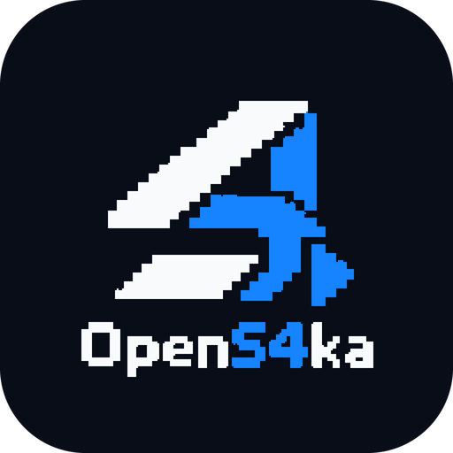
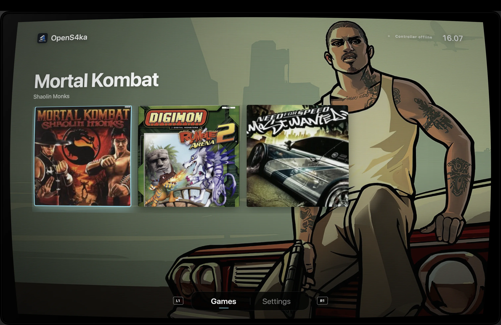

# OpenS4ka

  

OpenS4ka is a native macOS launcher and runtime for original Xbox games, statically recompiled to Apple Silicon arm64
C++ with [XboxXBE-Recomp](https://github.com/TGP482/XboxXBE-Recomp). It does not emulate the Xbox: each game's x86
code is converted to C++ ahead of time and built with a shared host. The launcher is SwiftUI and starts one native
runtime process per game. The host uses Vulkan through MoltenVK and SDL3 for windowing, input, and audio.

  

> [!IMPORTANT]
> OpenS4ka is an unofficial project for learning purposes and personal use. It is not affiliated with, endorsed by,
> or sponsored by Microsoft, Xbox, or the game copyright holders. Use only game files from your ISO.

## Download

[⬇️ Download the latest OpenS4ka macOS release](https://github.com/akimabs/opens4ka/releases/latest)

Download the latest **Apple Silicon macOS** release:

1. Download the `.dmg` file.
2. Open it and drag `OpenS4ka.app` to `Applications`.
3. Launch OpenS4ka from Applications. If macOS shows a security warning, Control-click the app and choose **Open**
   once.

The app supports macOS 13 or later on Apple Silicon. It does not include game files. In the launcher settings, choose
the ISO or extracted game folder you want to use.

A DualShock 4 (Bluetooth or USB) or any SDL-supported controller works. **Settings → Controller → Use PS2 button**
draws PlayStation button prompts (✕ ○ □ △, L1/R1/L2/R2) in place of the Xbox ones.

## Contributing

Project details, build instructions, release packaging, and the AI-agent contribution prompt are in
[contribute.md](contribute.md).

## Credits and license

- [XboxXBE-Recomp](https://github.com/TGP482/XboxXBE-Recomp) by TGP482 (MIT), the recompiler and runtime.
- SDL3, MoltenVK, glslang, toml++, Dear ImGui.

OpenS4ka is MIT licensed; see [LICENSE](LICENSE). Game names and trademarks belong to their owners.
